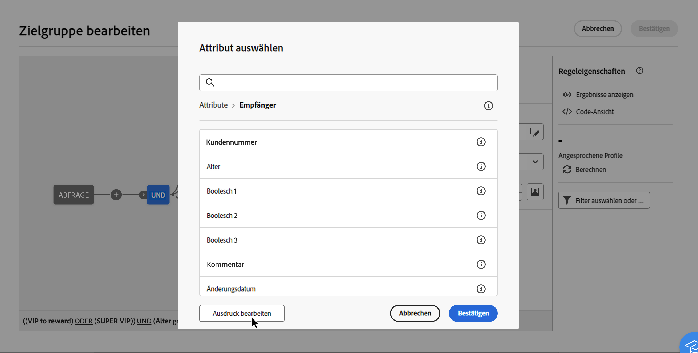
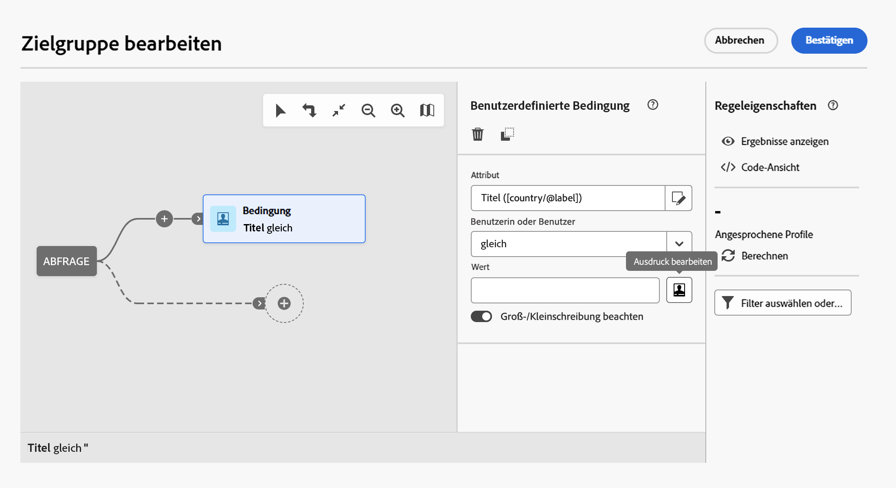
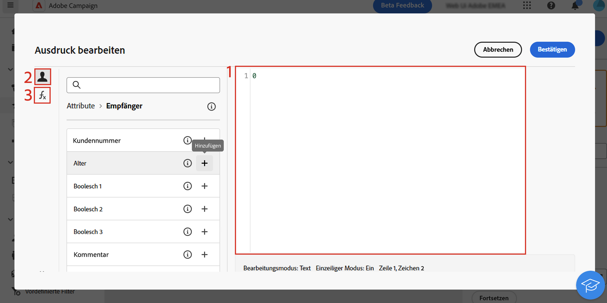
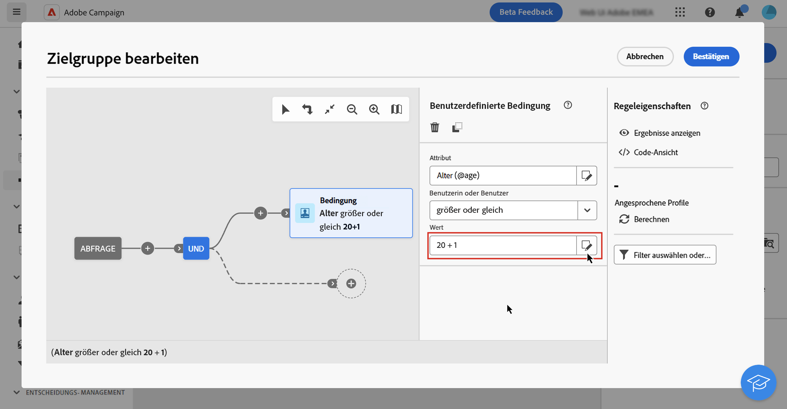

# Überblick über den Ausdruckseditor {#expression}

Die Bearbeitung von Ausdrücken erfolgt durch die manuelle Eingabe von Bedingungen, die in ihrer Gesamtheit eine Regel bilden. Dieser Modus bietet erweiterte Funktionen, mit denen Sie die Werte zur Durchführung bestimmter Abfragen ändern können, z. B. Bearbeitung von Daten, Zeichenfolgen, Nummernfeldern, Sortierungen, usw.

## Arbeiten mit dem Ausdruckseditor {#edit}

Der Ausdruckseditor steht bei der Konfiguration einer benutzerdefinierten Bedingung im Abfrage-Modeler unter **[!UICONTROL Ausdruck bearbeiten]** für die Felder **[!UICONTROL Attribut]** und **[!UICONTROL Wert]** zur Verfügung.

| Zugriff über das Feld **[!UICONTROL Attribut]** | Zugriff über das Feld **[!UICONTROL Wert]** |
|  ---  |  ---  |
| {zoomable="yes"}{width="200" align="center" zoomable="yes"} | {zoomable="yes"}{width="200" align="center" zoomable="yes"} |

Der Ausdruckseditor bietet Folgendes:

* Ein **Eingabefeld (1)**, in dem der Ausdruck definiert wird.
* Die Liste der verfügbaren **Felder (2)**, die im Ausdruck verwendet werden können und dem Schema, auch bekannt als Zielgruppendimension, der Abfrage entsprechen.
* **Hilfsfunktionen (3)**, sortiert nach Kategorie.

Bearbeiten Sie den Ausdruck, indem Sie ihn direkt in das Eingabefeld eingeben. Um ein Feld oder eine Hilfsfunktion hinzuzufügen, platzieren Sie den Cursor im Ausdruck an der Stelle, an der Sie es/sie hinzufügen möchten, und wählen Sie die Schaltfläche „+“ aus.

{zoomable="yes"}

Wenn der Ausdruck fertig ist, wählen Sie **[!UICONTROL Bestätigen]** aus. Der Ausdruck wird im ausgewählten Feld angezeigt. Öffnen Sie zum Bearbeiten den Ausdruckseditor und nehmen Sie die gewünschten Änderungen vor.

Das folgende Beispiel zeigt einen für das Feld **[!UICONTROL Wert]** konfigurierten Ausdruck. Um ihn zu bearbeiten, müssen Sie den Ausdruckseditor über die Schaltfläche **[!UICONTROL Ausdruck bearbeiten]** öffnen.

{zoomable="yes"}

## Hilfsfunktionen

Der Abfrageeditor bietet fortgeschrittene Funktionen zur Erstellung komplexer Filter, je nach den gewünschten Ergebnissen und der Art der bearbeiteten Daten. Folgende Funktionen stehen zur Verfügung:

### Datum

Die Datumsfunktionen dienen der Manipulation von Datums- oder Uhrzeitwerten.

>[!BEGINTABS]

>[!TAB Google BigQuery]

| Name | Beschreibung | Syntax | Beispiel |
| ---- | ----------- | ------ | ------- |
| **AddYears** | Fügt die angegebene Anzahl von Jahren zum angegebenen Datum und zur angegebenen Uhrzeit hinzu. | AddYears(&lt;DATUM/UHRZEIT>, &lt;ZAHL>) | AddYears(&quot;2019-12-25 15:30:00&quot;, 3) |
| **AddMonths** | Fügt die angegebene Anzahl von Monaten zum angegebenen Datum und zur angegebenen Uhrzeit hinzu. | AddMonths(&lt;DATUM/UHRZEIT>, &lt;ZAHL>) | AddMonths(&quot;2019-12-25 15:30:00&quot;, 6) |
| **AddDays** | Fügt die angegebene Anzahl von Tagen zum angegebenen Datum und zur angegebenen Uhrzeit hinzu. | AddDays(&lt;DATUM/UHRZEIT>, &lt;ZAHL>) | AddDays(&quot;2019-12-25 15:30:00&quot;, 10) |
| **AddHours** | Fügt die angegebene Anzahl von Stunden zum angegebenen Datum und zur angegebenen Uhrzeit hinzu. | AddHours(&lt;DATUM/UHRZEIT>, &lt;ZAHL>) | AddHours(&quot;2019-12-25 15:30:00&quot;, 3) |
| **AddMinutes** | Fügt die angegebene Anzahl von Minuten zum angegebenen Datum und zur angegebenen Uhrzeit hinzu. | AddMinutes(&lt;DATUM/UHRZEIT>, &lt;ZAHL>) | AddMinutes(&quot;2019-12-25 15:30:00&quot;, 32) |
| **AddSeconds** | Fügt die angegebene Anzahl von Sekunden zum angegebenen Datum und zur angegebenen Uhrzeit hinzu. | AddSeconds(&lt;DATUM/UHRZEIT>, &lt;ZAHL>) | AddSeconds(&quot;2019-12-25 15:30:00&quot;, 37) |
| **SubYears** | Zieht die angegebene Anzahl von Jahren vom angegebenen Datum und der angegebenen Uhrzeit ab. | SubYears(&lt;DATUM/UHRZEIT>, &lt;ZAHL>) | SubYears(&quot;2019-12-25 15:30:00&quot;, 3) |
| **SubMonths** | Zieht die angegebene Anzahl von Monaten vom angegebenen Datum und der angegebenen Uhrzeit ab. | SubMonths(&lt;DATUM/UHRZEIT>, &lt;ZAHL>) | SubMonths(&quot;2019-12-25 15:30:00&quot;, 6) |
| **SubDays** | Zieht die angegebene Anzahl von Tagen vom angegebenen Datum und der angegebenen Uhrzeit ab. | SubDays(&lt;DATUM/UHRZEIT>, &lt;ZAHL>) | SubDays(&quot;2019-12-25 15:30:00&quot;, 10) |
| **SubHours** | Zieht die angegebene Anzahl von Stunden vom angegebenen Datum und der angegebenen Uhrzeit ab. | SubHours(&lt;DATUM/UHRZEIT>, &lt;ZAHL>) | SubHours(&quot;2019-12-25 15:30:00&quot;, 3) |
| **SubMinutes** | Zieht die angegebene Anzahl von Minuten vom angegebenen Datum und der angegebenen Uhrzeit ab. | SubMinutes(&lt;DATUM/UHRZEIT>, &lt;ZAHL>) | SubMinutes(&quot;2019-12-25 15:30:00&quot;, 32) |
| **SubSeconds** | Zieht die angegebene Anzahl von Sekunden vom angegebenen Datum und der angegebenen Uhrzeit ab. | SubSeconds(&lt;DATUM/UHRZEIT>, &lt;ZAHL>) | SubSeconds(&quot;2019-12-25 15:30:00&quot;, 37) |
| **Year** | Extrahiert das Jahr aus dem angegebenen Objekt „Datum/Uhrzeit“. | Year(&lt;DATUM/UHRZEIT>) | Year(&quot;2019-12-15 15:30:00&quot;) |
| **Month** | Extrahiert den Monat aus dem angegebenen Objekt „Datum/Uhrzeit“. | Month(&lt;DATUM/UHRZEIT>) | Month(&quot;2019-12-15 15:30:00&quot;) |
| **Day** | Extrahiert den Tag aus dem angegebenen Objekt „Datum/Uhrzeit“. | Day(&lt;DATUM/UHRZEIT>) | Day(&quot;2019-12-15 15:30:00&quot;) |
| **DayOfYear** | Extrahiert den Tag des Jahres aus dem angegebenen Objekt „Datum/Uhrzeit“. Wenn der angegebene Wert für „Datum/Uhrzeit“ beispielsweise „2. Februar“ ist, wird „33“ zurückgegeben. | DayOfYear(&lt;DATUM/UHRZEIT>) | DayOfYear(&quot;2019-12-15 15:30:00&quot;) |
| **WeekDay** | Extrahiert den Wochentag aus dem angegebenen Objekt „Datum/Uhrzeit“ als eine Zahl von 0 bis 6, wobei 0 für Sonntag steht. | Year(&lt;DATUM/UHRZEIT>) | Year(&quot;2019-12-15 15:30:00&quot;) |
| **Hour** | Extrahiert den Stundenwert aus dem angegebenen Objekt „Datum/Uhrzeit“. | Year(&lt;DATUM/UHRZEIT>) | Year(&quot;2019-12-15 15:30:00&quot;) |
| **Minute** | Extrahiert den Minutenwert aus dem angegebenen Objekt „Datum/Uhrzeit“. | Year(&lt;DATUM/UHRZEIT>) | Year(&quot;2019-12-15 15:30:00&quot;) |
| **Second** | Extrahiert den Sekundenwert aus dem angegebenen Objekt „Datum/Uhrzeit“. | Year(&lt;DATUM/UHRZEIT>) | Year(&quot;2019-12-15 15:30:00&quot;) |
| **YearsDiff** | Gibt den Unterschied zwischen den angegebenen Datums- und Uhrzeitwerten mit einer Genauigkeit von Jahren an. | YearsDiff(&lt;DATUM/UHRZEIT>, &lt;DATUM/UHRZEIT>) | YearsDiff(&quot;2019-12-25 15:30:00&quot;, &quot;2018-10-14 18:35:27&quot;) |
| **MonthsDiff** | Gibt den Unterschied zwischen den angegebenen Datums- und Uhrzeitwerten mit einer Genauigkeit von Monaten an. | MonthsDiff(&lt;DATUM/UHRZEIT>, &lt;DATUM/UHRZEIT>) | MonthsDiff(&quot;2019-12-25 15:30:00&quot;, &quot;2018-10-14 18:35:27&quot;) |
| **DaysDiff** | Gibt den Unterschied zwischen den angegebenen Datums- und Uhrzeitwerten mit einer Genauigkeit von Tagen an. | DaysDiff(&lt;DATUM/UHRZEIT>, &lt;DATUM/UHRZEIT>) | DaysDiff(&quot;2019-12-25 15:30:00&quot;, &quot;2018-10-14 18:35:27&quot;) |
| **HoursDiff** | Gibt den Unterschied zwischen den angegebenen Datums- und Uhrzeitwerten mit einer Genauigkeit von Stunden an. | HoursDiff(&lt;DATUM/UHRZEIT>, &lt;DATUM/UHRZEIT>) | HoursDiff(&quot;2019-12-25 15:30:00&quot;, &quot;2018-10-14 18:35:27&quot;) |
| **MinutesDiff** | Gibt den Unterschied zwischen den angegebenen Datums- und Uhrzeitwerten mit einer Genauigkeit von Minuten an. | MinutesDiff(&lt;DATUM/UHRZEIT>, &lt;DATUM/UHRZEIT>) | MinutesDiff(&quot;2019-12-25 15:30:00&quot;, &quot;2018-10-14 18:35:27&quot;) |
| **SecondsDiff** | Gibt den Unterschied zwischen den angegebenen Datums- und Uhrzeitwerten mit einer Genauigkeit von Sekunden an. | SecondsDiff(&lt;DATUM/UHRZEIT>, &lt;DATUM/UHRZEIT>) | SecondsDiff(&quot;2019-12-25 15:30:00&quot;, &quot;2018-10-14 18:35:27&quot;) |
| **YearsOld** | Gibt den Unterschied zwischen dem angegebenen Datums- und Uhrzeitwert und der aktuellen Zeit mit einer Genauigkeit von Jahren an. | YearsOld(&lt;DATUM/UHRZEIT>) | YearsOld(&quot;2019-12-25 15:30:00&quot;) |
| **MonthsOld** | Gibt den Unterschied zwischen dem angegebenen Datums- und Uhrzeitwert und der aktuellen Zeit mit einer Genauigkeit von Monaten an. | MonthsOld(&lt;DATUM/UHRZEIT>) | MonthsOld(&quot;2019-12-25 15:30:00&quot;) |
| **DaysOld** | Gibt den Unterschied zwischen dem angegebenen Datums- und Uhrzeitwert und der aktuellen Zeit mit einer Genauigkeit von Tagen an. | DaysOld(&lt;DATUM/UHRZEIT>) | DaysOld(&quot;2019-12-25 15:30:00&quot;) |
| **GetDate** | Ruft das aktuelle Datum des Servers ab. | GetDate() | GetDate() |
| **DateOnly** | Kürzt „Datum/Uhrzeit“ auf Jahr, Monat und Tag. | DateOnly(&lt;DATUM/UHRZEIT>) | DateOnly(&quot;2019-12-25 15:30:00&quot;) |
| **ToDate** | Konvertiert das Feld in ein Datumsfeld. | ToDate(&lt;DATUM/UHRZEIT>) | ToDate(&quot;2019-12-25 15:30:00&quot;) |
| **ToDateTime** | Konvertiert das Feld in ein Feld mit Datum und Uhrzeit. | ToDateTime(&lt;DATUM>) | ToDateTime(&quot;2019-12-25 15:30:00&quot;) |
| **ToTimestamp** | Konvertiert das Feld in ein Zeitstempelfeld. | ToTimestamp(&lt;DATUM/UHRZEIT>) | ToTimestamp(&quot;2019-12-25 15:30:00&quot;) |
| **Oldest** | Gibt das älteste Datum unter den beiden angegebenen zurück. | Oldest(&lt;DATUM/UHRZEIT>, &lt;DATUM/UHRZEIT>) | Oldest(&quot;2015-02-13 11:59:59&quot;, &quot;2016-04-13 19:28:14&quot;) |
| **TruncDate** | Kürzt „Datum/Uhrzeit“ auf die nächste Einheit, basierend auf dem angegebenen numerischen Wert. Wenn der numerische Wert gleich 60 ist, wird auf die nächste Minute gekürzt. Wenn der numerische Wert gleich 3.600 ist, wird auf die nächste Stunde gekürzt. Wenn der numerische Wert gleich 86.400 ist, wird auf den nächsten Tag gekürzt. Andernfalls wird auf die nächste Sekunde gekürzt. | TruncDate(&lt;DATUM/UHRZEIT>, &lt;ZAHL>) | TruncDate(&quot;2016-04-13 19:28:14&quot;, 3600) |
| **TruncDateTZ** | Kürzt „Datum/Uhrzeit“ auf die nächste Einheit, basierend auf dem angegebenen numerischen Wert, und setzt „Datum/Uhrzeit“ auf die angegebene Zeitzone. Wenn der numerische Wert gleich 60 ist, wird auf die nächste Minute gekürzt. Wenn der numerische Wert gleich 3600 ist, wird auf die nächste Stunde gekürzt. Wenn der numerische Wert gleich 86.400 ist, wird auf den nächstgelegenen Tag gekürzt. | TruncDateTZ(&lt;DATUM/UHRZEIT>, &lt;ZAHL>, &lt;ZEITZONE>) | TruncDateTZ(&quot;2016-04-13 19:28:14&quot;, 3600, &quot;Amerika/Los_Angeles&quot;) |
| **TruncTime** | Legt Datum/Uhrzeit auf den 1. Januar 2000 fest und rundet den Rest von Datum/Uhrzeit auf die nächste Einheit, basierend auf dem angegebenen numerischen Wert.Wenn der numerische Wert gleich 60 ist, wird auf die nächste Minute gekürzt. Wenn der numerische Wert gleich 3.600 ist, wird auf die nächste Stunde gekürzt. | TruncTime(&lt;DATUM/UHRZEIT>, &lt;ZAHL>) | TruncTime(&quot;2016-04-13 19:28:14&quot;, 3600) |
| **TruncQuarter** | Kürzt „Datum/Uhrzeit“ auf das erste Datum im nächstgelegenen Quartal. | TruncQuarter(&lt;DATUM/UHRZEIT>) | TruncQuarter(&quot;2016-04-13 19:28:14&quot;) |
| **TruncYear** | Kürzt „Datum/Uhrzeit“ auf das erste Datum im nächsten Jahr. | TruncYear(&lt;DATUM/UHRZEIT>) | TruncYear(&quot;2016-04-13 19:28:14&quot;) |
| **TruncWeek** | Kürzt „Datum/Uhrzeit“ auf den Sonntag der nächstliegenden Woche. | TruncWeek(&lt;DATUM/UHRZEIT>) | TruncWeek(&quot;2016-04-13 19:28:14&quot;) |

>[!TAB Snowflake]

| Name | Beschreibung | Syntax | Beispiel |
| ---- | ----------- | ------ | ------- |
| **AddYears** | Fügt die angegebene Anzahl von Jahren zum angegebenen Datum und zur angegebenen Uhrzeit hinzu. | AddYears(&lt;DATUM/UHRZEIT>, &lt;ZAHL>) | AddYears(&quot;2019-12-25 15:30:00&quot;, 3) |
| **AddMonths** | Fügt die angegebene Anzahl von Monaten zum angegebenen Datum und zur angegebenen Uhrzeit hinzu. | AddMonths(&lt;DATUM/UHRZEIT>, &lt;ZAHL>) | AddMonths(&quot;2019-12-25 15:30:00&quot;, 6) |
| **AddDays** | Fügt die angegebene Anzahl von Tagen zum angegebenen Datum und zur angegebenen Uhrzeit hinzu. | AddDays(&lt;DATUM/UHRZEIT>, &lt;ZAHL>) | AddDays(&quot;2019-12-25 15:30:00&quot;, 10) |
| **AddHours** | Fügt die angegebene Anzahl von Stunden zum angegebenen Datum und zur angegebenen Uhrzeit hinzu. | AddHours(&lt;DATUM/UHRZEIT>, &lt;ZAHL>) | AddHours(&quot;2019-12-25 15:30:00&quot;, 3) |
| **AddMinutes** | Fügt die angegebene Anzahl von Minuten zum angegebenen Datum und zur angegebenen Uhrzeit hinzu. | AddMinutes(&lt;DATUM/UHRZEIT>, &lt;ZAHL>) | AddMinutes(&quot;2019-12-25 15:30:00&quot;, 32) |
| **AddSeconds** | Fügt die angegebene Anzahl von Sekunden zum angegebenen Datum und zur angegebenen Uhrzeit hinzu. | AddSeconds(&lt;DATUM/UHRZEIT>, &lt;ZAHL>) | AddSeconds(&quot;2019-12-25 15:30:00&quot;, 37) |
| **SubYears** | Zieht die angegebene Anzahl von Jahren vom angegebenen Datum und der angegebenen Uhrzeit ab. | SubYears(&lt;DATUM/UHRZEIT>, &lt;ZAHL>) | SubYears(&quot;2019-12-25 15:30:00&quot;, 3) |
| **SubMonths** | Zieht die angegebene Anzahl von Monaten vom angegebenen Datum und der angegebenen Uhrzeit ab. | SubMonths(&lt;DATUM/UHRZEIT>, &lt;ZAHL>) | SubMonths(&quot;2019-12-25 15:30:00&quot;, 6) |
| **SubDays** | Zieht die angegebene Anzahl von Tagen vom angegebenen Datum und der angegebenen Uhrzeit ab. | SubDays(&lt;DATUM/UHRZEIT>, &lt;ZAHL>) | SubDays(&quot;2019-12-25 15:30:00&quot;, 10) |
| **SubHours** | Zieht die angegebene Anzahl von Stunden vom angegebenen Datum und der angegebenen Uhrzeit ab. | SubHours(&lt;DATUM/UHRZEIT>, &lt;ZAHL>) | SubHours(&quot;2019-12-25 15:30:00&quot;, 3) |
| **SubMinutes** | Zieht die angegebene Anzahl von Minuten vom angegebenen Datum und der angegebenen Uhrzeit ab. | SubMinutes(&lt;DATUM/UHRZEIT>, &lt;ZAHL>) | SubMinutes(&quot;2019-12-25 15:30:00&quot;, 32) |
| **SubSeconds** | Zieht die angegebene Anzahl von Sekunden vom angegebenen Datum und der angegebenen Uhrzeit ab. | SubSeconds(&lt;DATUM/UHRZEIT>, &lt;ZAHL>) | SubSeconds(&quot;2019-12-25 15:30:00&quot;, 37) |
| **Year** | Extrahiert das Jahr aus dem angegebenen Objekt „Datum/Uhrzeit“. | Year(&lt;DATUM/UHRZEIT>) | Year(&quot;2019-12-15 15:30:00&quot;) |
| **Month** | Extrahiert den Monat aus dem angegebenen Objekt „Datum/Uhrzeit“. | Month(&lt;DATUM/UHRZEIT>) | Month(&quot;2019-12-15 15:30:00&quot;) |
| **Day** | Extrahiert den Tag aus dem angegebenen Objekt „Datum/Uhrzeit“. | Day(&lt;DATUM/UHRZEIT>) | Day(&quot;2019-12-15 15:30:00&quot;) |
| **DayOfYear** | Extrahiert den Tag des Jahres aus dem angegebenen Objekt „Datum/Uhrzeit“. Wenn der angegebene Wert für „Datum/Uhrzeit“ beispielsweise „2. Februar“ ist, wird „33“ zurückgegeben. | DayOfYear(&lt;DATUM/UHRZEIT>) | DayOfYear(&quot;2019-12-15 15:30:00&quot;) |
| **WeekDay** | Extrahiert den Wochentag aus dem angegebenen Objekt „Datum/Uhrzeit“ als eine Zahl von 1 bis 7, wobei 1 für Sonntag steht. | Year(&lt;DATUM/UHRZEIT>) | Year(&quot;2019-12-15 15:30:00&quot;) |
| **Hour** | Extrahiert den Stundenwert aus dem angegebenen Objekt „Datum/Uhrzeit“. | Year(&lt;DATUM/UHRZEIT>) | Year(&quot;2019-12-15 15:30:00&quot;) |
| **Minute** | Extrahiert den Minutenwert aus dem angegebenen Objekt „Datum/Uhrzeit“. | Year(&lt;DATUM/UHRZEIT>) | Year(&quot;2019-12-15 15:30:00&quot;) |
| **Second** | Extrahiert den Sekundenwert aus dem angegebenen Objekt „Datum/Uhrzeit“. | Year(&lt;DATUM/UHRZEIT>) | Year(&quot;2019-12-15 15:30:00&quot;) |
| **YearsDiff** | Gibt den Unterschied zwischen den angegebenen Datums- und Uhrzeitwerten mit einer Genauigkeit von Jahren an. | YearsDiff(&lt;DATUM/UHRZEIT>, &lt;DATUM/UHRZEIT>) | YearsDiff(&quot;2019-12-25 15:30:00&quot;, &quot;2018-10-14 18:35:27&quot;) |
| **MonthsDiff** | Gibt den Unterschied zwischen den angegebenen Datums- und Uhrzeitwerten mit einer Genauigkeit von Monaten an. | MonthsDiff(&lt;DATUM/UHRZEIT>, &lt;DATUM/UHRZEIT>) | MonthsDiff(&quot;2019-12-25 15:30:00&quot;, &quot;2018-10-14 18:35:27&quot;) |
| **DaysDiff** | Gibt den Unterschied zwischen den angegebenen Datums- und Uhrzeitwerten mit einer Genauigkeit von Tagen an. | DaysDiff(&lt;DATUM/UHRZEIT>, &lt;DATUM/UHRZEIT>) | DaysDiff(&quot;2019-12-25 15:30:00&quot;, &quot;2018-10-14 18:35:27&quot;) |
| **HoursDiff** | Gibt den Unterschied zwischen den angegebenen Datums- und Uhrzeitwerten mit einer Genauigkeit von Stunden an. | HoursDiff(&lt;DATUM/UHRZEIT>, &lt;DATUM/UHRZEIT>) | HoursDiff(&quot;2019-12-25 15:30:00&quot;, &quot;2018-10-14 18:35:27&quot;) |
| **MinutesDiff** | Gibt den Unterschied zwischen den angegebenen Datums- und Uhrzeitwerten mit einer Genauigkeit von Minuten an. | MinutesDiff(&lt;DATUM/UHRZEIT>, &lt;DATUM/UHRZEIT>) | MinutesDiff(&quot;2019-12-25 15:30:00&quot;, &quot;2018-10-14 18:35:27&quot;) |
| **SecondsDiff** | Gibt den Unterschied zwischen den angegebenen Datums- und Uhrzeitwerten mit einer Genauigkeit von Sekunden an. | SecondsDiff(&lt;DATUM/UHRZEIT>, &lt;DATUM/UHRZEIT>) | SecondsDiff(&quot;2019-12-25 15:30:00&quot;, &quot;2018-10-14 18:35:27&quot;) |
| **MonthsOld** | Gibt den Unterschied zwischen dem angegebenen Datums- und Uhrzeitwert und der aktuellen Zeit mit einer Genauigkeit von Monaten an. | MonthsOld(&lt;DATUM/UHRZEIT>) | MonthsOld(&quot;2019-12-25 15:30:00&quot;) |
| **DaysOld** | Gibt den Unterschied zwischen dem angegebenen Datums- und Uhrzeitwert und der aktuellen Zeit mit einer Genauigkeit von Tagen an. | DaysOld(&lt;DATUM/UHRZEIT>) | DaysOld(&quot;2019-12-25 15:30:00&quot;) |
| **GetDate** | Ruft das aktuelle Datum des Servers ab. | GetDate() | GetDate() |
| **DateOnly** | Kürzt „Datum/Uhrzeit“ auf Jahr, Monat und Tag. | DateOnly(&lt;DATUM/UHRZEIT>) | DateOnly(&quot;2019-12-25 15:30:00&quot;) |
| **ToDate** | Konvertiert das Feld in ein Datumsfeld. | ToDate(&lt;DATUM/UHRZEIT>) | ToDate(&quot;2019-12-25 15:30:00&quot;) |
| **ToDateTime** | Konvertiert das Feld in ein Feld mit Datum und Uhrzeit. | ToDateTime(&lt;DATUM>) | ToDateTime(&quot;2019-12-25 15:30:00&quot;) |
| **ToTimestamp** | Konvertiert das Feld in ein Zeitstempelfeld. | ToTimestamp(&lt;DATUM/UHRZEIT>) | ToTimestamp(&quot;2019-12-25 15:30:00&quot;) |
| **Oldest** | Gibt das älteste Datum unter den beiden angegebenen zurück. | Oldest(&lt;DATUM/UHRZEIT>, &lt;DATUM/UHRZEIT>) | Oldest(&quot;2015-02-13 11:59:59&quot;, &quot;2016-04-13 19:28:14&quot;) |
| **TruncDate** | Kürzt „Datum/Uhrzeit“ auf die nächste Einheit, basierend auf dem angegebenen numerischen Wert. Wenn der numerische Wert gleich 60 ist, wird auf die nächste Minute gekürzt. Wenn der numerische Wert gleich 3.600 ist, wird auf die nächste Stunde gekürzt. Wenn der numerische Wert gleich 86.400 ist, wird auf den nächsten Tag gekürzt. Andernfalls wird auf die nächste Sekunde gekürzt. | TruncDate(&lt;DATUM/UHRZEIT>, &lt;ZAHL>) | TruncDate(&quot;2016-04-13 19:28:14&quot;, 3600) |
| **TruncDateTZ** | Kürzt „Datum/Uhrzeit“ auf die nächste Einheit, basierend auf dem angegebenen numerischen Wert, und setzt „Datum/Uhrzeit“ auf die angegebene Zeitzone. Wenn der numerische Wert gleich 60 ist, wird auf die nächste Minute gekürzt. Wenn der numerische Wert gleich 3600 ist, wird auf die nächste Stunde gekürzt. Wenn der numerische Wert gleich 86.400 ist, wird auf den nächstgelegenen Tag gekürzt. | TruncDateTZ(&lt;DATUM/UHRZEIT>, &lt;ZAHL>, &lt;ZEITZONE>) | TruncDateTZ(&quot;2016-04-13 19:28:14&quot;, 3600, &quot;Amerika/Los_Angeles&quot;) |
| **TruncTime** | Legt Datum/Uhrzeit auf den 1. Januar 2000 fest und rundet den Rest von Datum/Uhrzeit auf die nächste Einheit, basierend auf dem angegebenen numerischen Wert.Wenn der numerische Wert gleich 60 ist, wird auf die nächste Minute gekürzt. Wenn der numerische Wert gleich 3.600 ist, wird auf die nächste Stunde gekürzt. | TruncTime(&lt;DATUM/UHRZEIT>, &lt;ZAHL>) | TruncTime(&quot;2016-04-13 19:28:14&quot;, 3600) |
| **TruncQuarter** | Kürzt „Datum/Uhrzeit“ auf das erste Datum im nächstgelegenen Quartal. | TruncQuarter(&lt;DATUM/UHRZEIT>) | TruncQuarter(&quot;2016-04-13 19:28:14&quot;) |
| **TruncYear** | Kürzt „Datum/Uhrzeit“ auf das erste Datum im nächsten Jahr. | TruncYear(&lt;DATUM/UHRZEIT>) | TruncYear(&quot;2016-04-13 19:28:14&quot;) |
| **TruncWeek** | Kürzt „Datum/Uhrzeit“ auf den Sonntag der nächstliegenden Woche. | TruncWeek(&lt;DATUM/UHRZEIT>) | TruncWeek(&quot;2016-04-13 19:28:14&quot;) |
| **ConvertNTZ** | Konvertiert einen Zeitstempel ohne Zeitzone in einen Zeitstempel mit Zeitzone. Die angehängte Zeitzone ist die Zeitzone des externen Kontos. | ConvertNTZ(&lt;DATUM/UHRZEIT>) | ConvertNTZ(&quot;2024-06-24 14:43:49&quot;) |

>[!ENDTABS]

>[!NOTE]
>
>Beachten Sie, dass die Funktion **Dateonly** nicht die Zeitzone der nutzenden Person, sondern des Servers verwendet.

### Geomarketing

Die Geomarketing-Funktionen dienen der Manipulation von geografischen Werten.

>[!BEGINTABS]

>[!TAB Google BigQuery]

| Name | Beschreibung | Syntax | Beispiel |
| ---- | ----------- | ------ | ------- |
| **Distance** | Gibt die Entfernung zwischen zwei durch Längen- und Breitengrad definierten Punkten in Grad als Duplikat zurück. | Distance(&lt;ZAHL>, &lt;ZAHL>, &lt;ZAHL>, &lt;ZAHL>) | Distance(40.345, 39.2345, -35.5834, 34.599) |

>[!TAB Snowflake]

| Name | Beschreibung | Syntax | Beispiel |
| ---- | ----------- | ------ | ------- |
| **Distance** | Gibt die Entfernung zwischen zwei durch Längen- und Breitengrad definierten Punkten in Grad als Duplikat zurück. | Distance(&lt;ZAHL>, &lt;ZAHL>, &lt;ZAHL>, &lt;ZAHL>) | Distance(40.345, 39.2345, -35.5834, 34.599) |

>[!ENDTABS]

### Numerisch

Die numerischen Funktionen dienen der Konversion von Text in Zahlen.

>[!BEGINTABS]

>[!TAB Google BigQuery]

| Name | Beschreibung | Syntax | Beispiel |
| ---- | ----------- | ------ | ------- |
| **Mod** | Gibt den Rest zurück, der entsteht, wenn die erste Zahl durch die zweite Zahl geteilt wird. | Mod(&lt;ZAHL>, &lt;ZAHL>) | Mod(3, 2) |
| **Percent** | Berechnet, wie viel Prozent die erste Zahl von der zweiten Zahl ist. | Percent(&lt;ZAHL>, &lt;ZAHL>) | Prozent(1, 2) |
| **Random** | Gibt eine zufällige Zahl zwischen 0 (inklusive) und 1 (exklusive) zurück. | Random() | Random() |
| **Round** | Gibt die angegebene Zahl gerundet auf die nächste angeforderte Dezimalstelle zurück. | Round(&lt;ZAHL>, &lt;ZAHL>) | Round(4.5394, 2) |
| **ToDouble** | Konvertiert die angegebene Zahl in ein Doppel. | ToDouble(&lt;ZAHL>) | ToDouble(5) |
| **ToInteger** | Konvertiert die angegebene Zahl in eine Ganzzahl. | ToInteger(&lt;ZAHL>) | ToInteger(45) |
| **ToInt64** | Konvertiert die angegebene Zahl in eine 64-Bit-Ganzzahl. | ToInt64(&lt;ZAHL>) | ToInt64(493) |
| **Trunc** | Kürzt die angegebene Zahl auf die angeforderte Anzahl an Dezimalstellen. | Trunc(&lt;ZAHL>, &lt;ZAHL>) | Trunc(36.9348934, 3) |

>[!TAB Snowflake]

| Name | Beschreibung | Syntax | Beispiel |
| ---- | ----------- | ------ | ------- |
| **Mod** | Gibt den Rest zurück, der entsteht, wenn die erste Zahl durch die zweite Zahl geteilt wird. | Mod(&lt;ZAHL>, &lt;ZAHL>) | Mod(3, 2) |
| **Percent** | Berechnet, wie viel Prozent die erste Zahl von der zweiten Zahl ist. | Percent(&lt;ZAHL>, &lt;ZAHL>) | Prozent(1, 2) |
| **Random** | Gibt eine zufällige Zahl zwischen 0 (inklusive) und 1 (exklusive) zurück. | Random() | Random() |
| **ToDouble** | Konvertiert die angegebene Zahl in ein Doppel. | ToDouble(&lt;ZAHL>) | ToDouble(5) |
| **ToInteger** | Konvertiert die angegebene Zahl in eine Ganzzahl. | ToInteger(&lt;ZAHL>) | ToInteger(45) |
| **ToInt64** | Konvertiert die angegebene Zahl in eine 64-Bit-Ganzzahl. | ToInt64(&lt;ZAHL>) | ToInt64(493) |
| **Trunc** | Kürzt die angegebene Zahl auf die angeforderte Anzahl an Dezimalstellen. | Trunc(&lt;ZAHL>, &lt;ZAHL>) | Trunc(36.9348934, 3) |

>[!ENDTABS]

### Sonstige

In dieser Tabelle sind die restlichen verfügbaren Funktionen enthalten.

>[!BEGINTABS]

>[!TAB Google BigQuery]

| Name | Beschreibung | Syntax | Beispiel |
| ---- | ----------- | ------ | ------- |
| **Case** | Gibt den ersten Wert zurück, wenn der Ausdruck wahr ist. Andernfalls wird der zweite Wert zurückgegeben. | Case(When(&lt;AUSDRUCK> &lt;WERT>), Else(&lt;WERT>)) | Case(When(a > b, &quot;ja&quot;), Else(&quot;nein&quot;)) |
| **When** | Wird als Teil der Case-Funktion verwendet. Wird verwendet, um den Ausdruck in der Case-Funktion zu überprüfen. | When(&lt;AUSDRUCK> &lt;WERT>) | When(a > b, &quot;ja&quot;) |
| **Else** | Wird als Teil der Case-Funktion verwendet. Wird verwendet, um die andere Option auszuwählen, wenn der When-Ausdruck falsch ist. | Else(&lt;VALUE>) | Else (&quot;nein&quot;) |
| **Coalesce** | Gibt den ersten Nicht-Null-Wert zurück. | Coalesce(&lt;WERT>, &lt;WERT>) | Coalesce (&quot;&quot;, &quot;String&quot;) |
| **Decode** | Gibt die erste Option zurück, wenn die Werte gleich sind. Gibt die zweite Option zurück, wenn die Werte nicht gleich sind. | Decode(&lt;WERT>, &lt;WERT>, &lt;WERT>, &lt;WERT>) | Decode(1, 2, &quot;wahr&quot;, &quot;falsch&quot;) |
| **GetEmailDomain** | Extrahiert die Domain der angegebenen E-Mail-Adresse. | GetEmailDomain(&lt;STRING>) | GetEmailDomain(&quot;`sample@example.com`&quot;) |
| **Iif** | Gibt die erste Option zurück, wenn die Bedingung wahr ist, und gibt die zweite Option zurück, wenn die Bedingung falsch ist. | Iif(&lt;BEDINGUNG>, &lt;WERT>, &lt;WERT>) | Iif(10 &lt; 20, &quot;wahr&quot;, &quot;falsch&quot;) |
| **IsEmptyString** | Gibt die erste Option zurück, wenn der String leer ist. Andernfalls wird die zweite Option zurückgegeben. | IsEmptyString( &lt;STRING> ,&lt;WERT>, &lt;WERT>) | IsEmptyString(&quot;String&quot;, &quot;ja&quot;, &quot;nein&quot;) |
| **NewUUID** | Generiert eine neue eindeutige UUID. | NewUUID() | NewUUID() |
| **NoNull** | Gibt den angegebenen String zurück, wenn er nicht leer ist, und gibt einen leeren String zurück, wenn der angegebene String leer ist. | NoNull(&lt;STRING>) | NoNull(&quot;Test&quot;) |
| **IsBitSet** | Führt ein bitweises Und (&amp;) für die angegebenen Zahlen durch. Auf diese Weise können Sie überprüfen, ob das Bit innerhalb des ersten Parameters an der Position gesetzt ist, die im zweiten Parameter angegeben ist. | IsBitSet(&lt;ZAHL>, &lt;ZAHL>) | IsBitSet(5, 3) |
| **ClearBit** | Dadurch können Sie das Bit innerhalb des ersten Parameters an der Position löschen, die im zweiten Parameter angegeben ist. | ClearBit(&lt;ZAHL>, &lt;ZAHL>) | |
| **SetBit** | Führt ein bitweises Oder (\|) für die angegebenen Zahlen durch. Dadurch können Sie das Bit innerhalb des ersten Parameters an der Position festlegen, die im zweiten Parameter angegeben ist. | SetBit(&lt;ZAHL>, &lt;ZAHL>) | SetBit(5, 3) |
| **RowId** | Gibt die Zeilennummer zurück. | RowId() | RowId() |
| **ToBoolean** | Konvertiert den Wert in einen booleschen Wert. | ToBoolean(&lt;WERT>) | ToBoolean(a=b) |

>[!TAB Snowflake]

| Name | Beschreibung | Syntax | Beispiel |
| ---- | ----------- | ------ | ------- |
| **Case** | Gibt den ersten Wert zurück, wenn der Ausdruck wahr ist. Andernfalls wird der zweite Wert zurückgegeben. | Case(When(&lt;AUSDRUCK> &lt;WERT>), Else(&lt;WERT>)) | Case(When(a > b, &quot;ja&quot;), Else(&quot;nein&quot;)) |
| **When** | Wird als Teil der Case-Funktion verwendet. Wird verwendet, um den Ausdruck in der Case-Funktion zu überprüfen. | When(&lt;AUSDRUCK> &lt;WERT>) | When(a > b, &quot;ja&quot;) |
| **Else** | Wird als Teil der Case-Funktion verwendet. Wird verwendet, um die andere Option auszuwählen, wenn der When-Ausdruck falsch ist. | Else(&lt;VALUE>) | Else (&quot;nein&quot;) |
| **GetEmailDomain** | Extrahiert die Domain der angegebenen E-Mail-Adresse. | GetEmailDomain(&lt;STRING>) | GetEmailDomain(&quot;`sample@example.com`&quot;) |
| **Iif** | Gibt die erste Option zurück, wenn die Bedingung wahr ist, und gibt die zweite Option zurück, wenn die Bedingung falsch ist. | Iif(&lt;BEDINGUNG>, &lt;WERT>, &lt;WERT>) | Iif(10 &lt; 20, &quot;wahr&quot;, &quot;falsch&quot;) |
| **IsEmptyString** | Gibt die erste Option zurück, wenn der String leer ist. Andernfalls wird die zweite Option zurückgegeben. | IsEmptyString( &lt;STRING> ,&lt;WERT>, &lt;WERT>) | IsEmptyString(&quot;String&quot;, &quot;ja&quot;, &quot;nein&quot;) |
| **ToBoolean** | Gibt „1“ zurück, wenn der Wert wahr ist. Gibt „0“ zurück, wenn der Wert falsch ist. | ToBoolean(&lt;WERT>) | ToBoolean(a=b) |
| **ToBooleanType** | Konvertiert den Wert in einen booleschen Wert. | ToBooleanType(&lt;WERT>) | ToBooleanType(a=b) |
| **IsBitSet** | Führt ein bitweises Und (&amp;) für die angegebenen Zahlen durch. Auf diese Weise können Sie überprüfen, ob das Bit innerhalb des ersten Parameters an der Position gesetzt ist, die im zweiten Parameter angegeben ist. | IsBitSet(&lt;ZAHL>, &lt;ZAHL>) | IsBitSet(5, 3) |
| **ClearBit** | Dadurch können Sie das Bit innerhalb des ersten Parameters an der Position löschen, die im zweiten Parameter angegeben ist. | ClearBit(&lt;ZAHL>, &lt;ZAHL>) | |
| **SetBit** | Führt ein bitweises Oder (\|) für die angegebenen Zahlen durch. Dadurch können Sie das Bit innerhalb des ersten Parameters an der Position festlegen, die im zweiten Parameter angegeben ist. | SetBit(&lt;ZAHL>, &lt;ZAHL>) | SetBit(5, 3) |
| **RowId** | Gibt die Zeilennummer zurück. | RowId() | RowId() |
| **NewUUID** | Generiert eine neue eindeutige UUID. | NewUUID() | NewUUID() |
| **NoNull** | Gibt den angegebenen String zurück, wenn er nicht leer ist, und gibt einen leeren String zurück, wenn der angegebene String leer ist. | NoNull(&lt;STRING>) | NoNull(&quot;Test&quot;) |
| **AESEncrypt** | Verschlüsselt den angegebenen String mit dem AES-Verschlüsselungstyp. | AESEncrypt() | AESEncrypt(&quot;hallo&quot;) |
| **ObjectConstruct** | Erstellt ein Objekt basierend auf den angegebenen Schlüssel/Wert-Paaren. | ObjectConstruct(&lt;STRING>, &lt;STRING>) | ObjectConstruct(&quot;Schlüssel&quot;, &quot;Wert&quot;) |

>[!ENDTABS]

### String

Die String-Funktionen dienen der Manipulation einer Reihe von Strings.

>[!BEGINTABS]

>[!TAB Google BigQuery]

| Name | Beschreibung | Syntax | Beispiel |
| ---- | ----------- | ------ | ------- |
| **AllNonNull2** | Nimmt zwei Strings und überprüft, ob alle nicht null und nicht leer sind. | AllNonNull2(&lt;STRING>, &lt;STRING>) | AllNonNull2(&quot;&quot;, &quot;String2&quot;) |
| **AllNonNull3** | Nimmt drei Strings und überprüft, ob alle nicht null und nicht leer sind | AllNonNull3(&lt;STRING>, &lt;STRING>, &lt;STRING>) | AllNonNull3(&quot;&quot;, &quot;eins&quot;, &quot;drei&quot;) |
| **Ascii** | Nimmt einen String und gibt das Ergebnis zurück. | Ascii(&lt;STRING>) | Ascii (&quot;foo&quot;) |
| **Char** | Nimmt ein Array von Unicode-Code-Punkten und gibt den resultierenden String zurück. | Char(&lt;ARRAY>) | Char([65, 68, 79, 66, 69]) |
| **Charindex** | Gibt das erste Vorkommen der angegebenen Unterzeichenfolge innerhalb der Hauptzeichenfolge an. | Charindex(&lt;STRING>, &lt;SUBSTRING>) | Charindex(&quot;bar@beispiel.com&quot;, &quot;@&quot;) |
| **dataLength** | Gibt die Anzahl der Byte im String zurück. | dataLength(&lt;STRING>) | dataLength(&quot;Mein String&quot;) |
| **GetLine** | Gibt die angeforderte Zeile des angegebenen Strings zurück. | GetLine(&lt;STRING>, &lt;ZAHL>) | GetLine(multilinestring, 5) |
| **IfEquals** | Nimmt vier Strings und gibt den dritten String zurück, wenn die ersten beiden Strings gleich sind, und gibt den vierten String zurück, wenn die ersten beiden Strings nicht gleich sind. | IfEquals(&lt;STRING>, &lt;STRING>, &lt;STRING>, &lt;STRING>) | IfEquals(&quot;a&quot;, &quot;a&quot;, &quot;ja&quot;, &quot;nein&quot;) |
| **IsMemoNull** | Gibt „1“ zurück, wenn der String null ist. Andernfalls wird „0“ zurückgegeben. | IsMemoNull(&lt;STRING>) | IsMemoNull(&quot;hallo&quot;) |
| **JuxtWords** | Nimmt zwei Strings und kombiniert sie zu einem einzigen String. Leerzeichen zwischen den Strings werden bei Bedarf hinzugefügt. | JuxtWords(&lt;STRING>, &lt;STRING>) | JuxtWords(&quot;Hallo&quot;, &quot;Welt&quot;) |
| **JuxtWords3** | Nimmt drei Strings und kombiniert sie zu einem einzigen String. Leerzeichen zwischen den Strings werden bei Bedarf hinzugefügt. | JuxtWords3(&lt;STRING>, &lt;STRING>, &lt;STRING>) | JuxtWords3(&quot;Hallo&quot;, &quot;Neue&quot;, &quot;Welt&quot;) |
| **Left** | Nimmt eine Zeichenfolge und gibt die Zeichen ganz links wie angegeben zurück. | Left(&lt;STRING>, &lt;ZAHL>) | Left(&quot;Unterzeichenfolge&quot;, 3) |
| **Length** | Gibt die Länge des Strings zurück. | Length(&lt;STRING>) | Length(&quot;Mein String&quot;) |
| **Md5Digest** | Konvertiert den MD5-Hash-String in seine hexadezimale Darstellung. | Md5Digest(&lt;STRING>) | Md5Digest(&quot;String&quot;) |
| **MemoContains** | Prüft, ob der String die angegebene Unterzeichenfolge enthält. | MemoContains(&lt;STRING>, &lt;STRING>) | MemoContains(&quot;String&quot;, &quot;str&quot;) |
| **Right** | Nimmt eine Zeichenfolge und gibt die Zeichen ganz rechts wie angegeben zurück. | Right(&lt;STRING>, &lt;NUMBER>) | Right(&quot;Unterzeichenfolge&quot;, 3) |
| **Smart** | Gibt jedes Wort des Strings beginnend mit einem Großbuchstaben zurück. | Smart(&lt;STRING>) | Smart(&quot;hallo welt&quot;) |
| **Substring** | Nimmt einen String und gibt einen Teil des angegebenen Strings zurück, basierend auf den angegebenen Positionen. | Substring(&lt;STRING>, &lt;LINKE_ZAHL>,&lt;RECHTE_ZAHL>) | Substring(&quot;Unterzeichenfolge&quot;, 3, 5) |
| **Sha256Digest** | Konvertiert den SHA256-Hash-String in seine hexadezimale Darstellung. | Sha256Digest(&lt;STRING>) | Sha256Digest(&quot;String&quot;) |
| **Sha512Digest** | Konvertiert den SHA512-Hash-String in seine hexadezimale Darstellung. | Sha512Digest(&lt;STRING>) | Sha512Digest(&quot;String&quot;) |
| **ToString** | Gibt den Wert als String zurück. | ToString(&lt;WERT>) | ToString(123) |

>[!TAB Snowflake]

| Name | Beschreibung | Syntax | Beispiel |
| ---- | ----------- | ------ | ------- |
| **AllNonNull2** | Nimmt zwei Strings und überprüft, ob alle nicht null und nicht leer sind. | AllNonNull2(&lt;STRING>, &lt;STRING>) | AllNonNull2(&quot;&quot;, &quot;String2&quot;) |
| **AllNonNull3** | Nimmt drei Strings und überprüft, ob alle nicht null und nicht leer sind | AllNonNull3(&lt;STRING>, &lt;STRING>, &lt;STRING>) | AllNonNull3(&quot;&quot;, &quot;eins&quot;, &quot;drei&quot;) |
| **Char** | Nimmt ein Array von Unicode-Code-Punkten und gibt den resultierenden String zurück. | Char(&lt;ARRAY>) | Char([65, 68, 79, 66, 69]) |
| **Charindex** | Gibt das erste Vorkommen der angegebenen Unterzeichenfolge innerhalb der Hauptzeichenfolge an. | Charindex(&lt;STRING>, &lt;SUBSTRING>) | Charindex(&quot;bar@beispiel.com&quot;, &quot;@&quot;) |
| **dataLength** | Gibt die Anzahl der Byte im String zurück. | dataLength(&lt;STRING>) | dataLength(&quot;Mein String&quot;) |
| **GetLine** | Gibt die angeforderte Zeile des angegebenen Strings zurück. | GetLine(&lt;STRING>, &lt;ZAHL>) | GetLine(multilinestring, 5) |
| **IfEquals** | Nimmt vier Strings und gibt den dritten String zurück, wenn die ersten beiden Strings gleich sind, und gibt den vierten String zurück, wenn die ersten beiden Strings nicht gleich sind. | IfEquals(&lt;STRING>, &lt;STRING>, &lt;STRING>, &lt;STRING>) | IfEquals(&quot;a&quot;, &quot;a&quot;, &quot;ja&quot;, &quot;nein&quot;) |
| **IsMemoNull** | Gibt „1“ zurück, wenn der String null ist. Andernfalls wird „0“ zurückgegeben. | IsMemoNull(&lt;STRING>) | IsMemoNull(&quot;hallo&quot;) |
| **JuxtWords** | Nimmt zwei Strings und kombiniert sie zu einem einzigen String. Leerzeichen zwischen den Strings werden bei Bedarf hinzugefügt. | JuxtWords(&lt;STRING>, &lt;STRING>) | JuxtWords(&quot;Hallo&quot;, &quot;Welt&quot;) |
| **JuxtWords3** | Nimmt drei Strings und kombiniert sie zu einem einzigen String. Leerzeichen zwischen den Strings werden bei Bedarf hinzugefügt. | JuxtWords3(&lt;STRING>, &lt;STRING>, &lt;STRING>) | JuxtWords3(&quot;Hallo&quot;, &quot;Neue&quot;, &quot;Welt&quot;) |
| **Left** | Nimmt eine Zeichenfolge und gibt die Zeichen ganz links wie angegeben zurück. | Left(&lt;STRING>, &lt;ZAHL>) | Left(&quot;Unterzeichenfolge&quot;, 3) |
| **Length** | Gibt die Länge des Strings zurück. | Length(&lt;STRING>) | Length(&quot;Mein String&quot;) |
| **Line** | Gibt die angegebene nummerierte Zeile aus dem String zurück. | Line(&lt;STRING>, &lt;ZAHL>) | Line(multilinestring, 5) |
| **Md5Digest** | Konvertiert den MD5-Hash-String in seine hexadezimale Darstellung. | Md5Digest(&lt;STRING>) | Md5Digest(&quot;String&quot;) |
| **Replace** | Nimmt einen String und ersetzt alle Instanzen der Unterzeichenfolge mit einer Ersatzunterzeichenfolge. | Replace(&lt;STRING>, &lt;STRING&amp;gt, &lt;STRING&amp;gt) | Replace(&quot;Kapitän Steve&quot;, &quot;Kapitän&quot;, &quot;Ingenieur&quot;) |
| **Right** | Nimmt eine Zeichenfolge und gibt die Zeichen ganz rechts wie angegeben zurück. | Right(&lt;STRING>, &lt;NUMBER>) | Right(&quot;Unterzeichenfolge&quot;, 3) |
| **Sha256Digest** | Konvertiert den SHA256-Hash-String in seine hexadezimale Darstellung. | Sha256Digest(&lt;STRING>) | Sha256Digest(&quot;String&quot;) |
| **Sha512Digest** | Konvertiert den SHA512-Hash-String in seine hexadezimale Darstellung. | Sha512Digest(&lt;STRING>) | Sha512Digest(&quot;String&quot;) |
| **Smart** | Gibt jedes Wort des Strings beginnend mit einem Großbuchstaben zurück. | Smart(&lt;STRING>) | Smart(&quot;hallo welt&quot;) |
| **ToString** | Gibt den Wert als String zurück. | ToString(&lt;WERT>) | ToString(123) |

>[!ENDTABS]

### Fenster

>[!BEGINTABS]

>[!TAB Google BigQuery]

| Name | Beschreibung | Syntax | Beispiel |
| ---- | ----------- | ------ | ------- |
| **RowNum** | Gibt eine Reihenfolge von Zeilen basierend auf der Tabellenpartition und der Sortierreihenfolge zurück. | RowNum(PartitionBy(&lt;AUSDRUCK>), OrderBy(&lt;AUSDRUCK>)) | RowNum(PartitionBy(division), OrderBy(time)) |
| **PartitionBy** | Trennt die Eingabezeilen in verschiedene Teile, basierend auf dem angegebenen Ausdruck. | PartitionBy(&lt;AUSDRUCK>) | PartitionBy(division) |
| **OrderBy** | Sortiert das Ergebnis innerhalb der Partition. | OrderBy(&lt;AUSDRUCK>) | OrderBy(age) |
| **Desc** | Sortiert „OrderBy“ in absteigender Reihenfolge anstatt in aufsteigender Reihenfolge. | Desc(OrderBy(&lt;AUSDRUCK>)) | Desc(OrderBy(age)) |

>[!TAB Snowflake]

| Name | Beschreibung | Syntax | Beispiel |
| ---- | ----------- | ------ | ------- |
| **RowNum** | Gibt eine Reihenfolge von Zeilen basierend auf der Tabellenpartition und der Sortierreihenfolge zurück. | RowNum(PartitionBy(&lt;AUSDRUCK>), OrderBy(&lt;AUSDRUCK>)) | RowNum(PartitionBy(division), OrderBy(time)) |
| **PartitionBy** | Trennt die Eingabezeilen in verschiedene Teile, basierend auf dem angegebenen Ausdruck. | PartitionBy(&lt;AUSDRUCK>) | PartitionBy(division) |
| **OrderBy** | Sortiert das Ergebnis innerhalb der Partition. | OrderBy(&lt;AUSDRUCK>) | OrderBy(age) |
| **Desc** | Sortiert „OrderBy“ in absteigender Reihenfolge anstatt in aufsteigender Reihenfolge. | Desc(OrderBy(&lt;AUSDRUCK>)) | Desc(OrderBy(age)) |

>[!ENDTABS]
